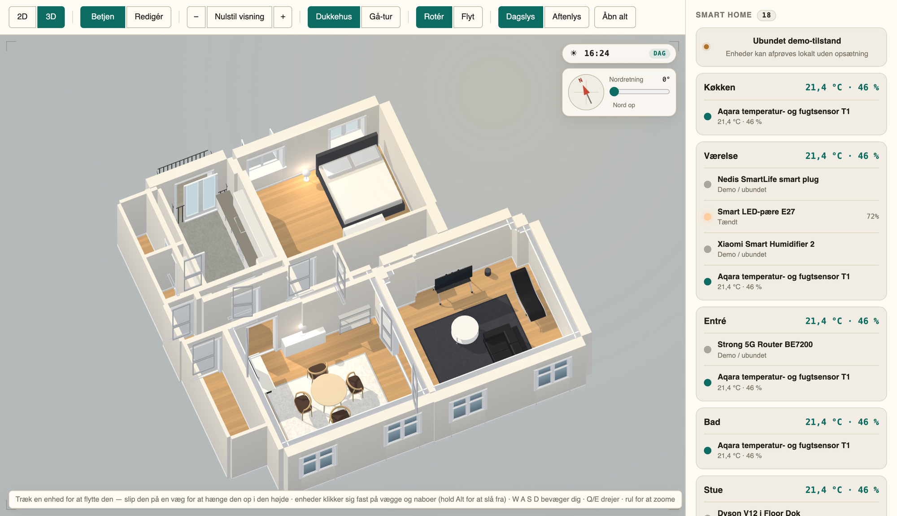
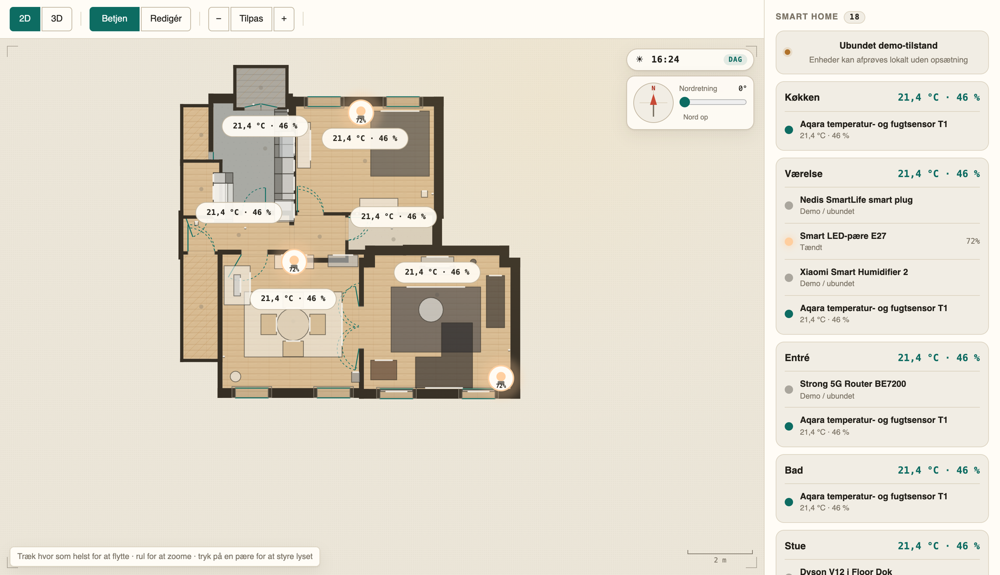
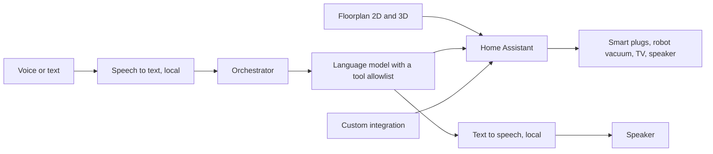

# Smart Home: Floorplan, Appliance Monitoring and Voice Control

A self-hosted smart home where a measured 3D floorplan is the interface, a smart plug reveals what the dishwasher is doing, and a voice assistant can only touch what it has been allowed to.

> **This is a case study with selected source files.** It is my own home, so the full code and configuration are private. Three source files are in [`code/`](code/).

| At a glance | |
|---|---|
| **Type** | Personal project |
| **Period** | August 2026 to present |
| **Status** | Running at home. The voice assistant is a working prototype. |
| **Stack** | Home Assistant, Python, JavaScript, Docker, MCP, Whisper, Piper |

## The problem

Smart home apps show a list of devices. That says little about the home, and the devices themselves are less reliable than the app suggests: a cheap smart plug that reports through a cloud service drops readings, and sometimes keeps showing a value that stopped being true days ago. Adding a voice assistant on top raises a different problem. Something that understands free speech and can switch things on needs firm limits.

## Why it matters

This is my testbed for two things I find interesting well beyond the home: building something dependable on top of signals that are not, and giving a language model limited control over physical things. Both come up in any business process that mixes messy data with automated action.

## What I built

Three parts on top of Home Assistant, which stays the engine for devices and automations.





*The same model in 3D and 2D. The furnishing is invented for this page, and the devices run in demo mode, where they can be tried without any hardware connected. The panel on the right lists the smart devices per room with their state. The interface is in Danish.*

1. **A floorplan as control surface.** The apartment is measured by hand and drawn to scale, with a 2D editor and a 3D view of the same model. Furniture and devices are objects with real dimensions that snap to walls. Devices on the plan are bound to Home Assistant and show live state.
2. **An integration that makes a dumb appliance observable.** Custom Python code that works out when the dishwasher is running, which program it is probably on, and what a run would cost at different start times. It also logs where the robot vacuum gets stuck.
3. **A voice assistant.** Wake word or push-to-talk on the computer, or dictation from a phone. Speech is transcribed locally, a language model decides what to do, and the answer is spoken through a local Danish voice.

## My role

My own home and my own project. I measured the apartment, chose what was worth automating and what was not, and set the rules for what the assistant may touch. The code was written by AI coding agents from my descriptions, and it runs against the real devices in my home.

## How it works



Home Assistant, a DNS-level ad blocker and a small web server run in Docker. The voice assistant runs as its own process next to them. Each stage of the voice pipeline sits behind an interface, so the speech engine or the model can be replaced.

## Key decisions

**A second witness for an unreliable sensor.** The plug on the dishwasher reports power through a cloud service. Once, a whole heating phase never arrived. Another time the power reading stayed at about 2 kW for three days after the machine had stopped. So the plug's energy counter is used as a second source: it can start a run that has no power reading, and it can end one whose power reading has gone stale.

**Guess the program, and learn from corrections.** The plug cannot say which program is running. It is estimated by comparing the run so far with earlier runs. A program I confirm by hand is stored as certain, so the estimates improve with use.

**Advice a person will act on.** The cheapest time to start the dishwasher can be most of a day away. The suggestion shown is the first start that is nearly as cheap, and a saving below a small threshold is reported as "start now".

**Narrow permissions for the language model.** The assistant sees and controls an explicit allowlist, currently three devices. One command runs at a time, with a limit on steps and a timeout. A failed action is not retried automatically, because a timeout after a command was sent may mean it already happened. Setup functions can only be reached from the computer itself, and a phone is paired with a one-time code that expires after three minutes.

## Selected implementation

What a dishwasher run costs if it starts at a given time. A run has a consumption curve, since most of the energy goes to heating, so the cost is the energy used in each quarter-hour price slot multiplied by that slot's price. If the known prices do not cover the whole run, the answer is "unknown" and not a partial sum.

```python
def run_cost(slots: list[list[float]], start: float, run: dict[str, Any]) -> float | None:
    """Kr for the run if it starts at `start`; None if prices do not cover it."""
    end = start + run["duration"]
    cost, covered = 0.0, start
    for slot, price in slots:
        if slot + SLOT_S <= start or slot >= end:
            continue
        if slot > covered + 1:
            return None
        a, b = max(slot, start), min(slot + SLOT_S, end)
        cost += price * (_used(run["curve"], run["kwh"], run["duration"], b - start)
                         - _used(run["curve"], run["kwh"], run["duration"], a - start))
        covered = b
    return cost if covered >= end - 1 else None
```

The price per slot is the day-ahead spot price plus the grid tariff for that hour, fixed charges and VAT. That is what a kilowatt-hour costs on the bill. This module has no dependency on Home Assistant, so it can be run on its own.

The full file is [`code/prices.py`](code/prices.py). [`code/cycles.py`](code/cycles.py) is the detection of dishwasher runs from power and energy readings, and [`code/validation.py`](code/validation.py) checks a floorplan document before it is stored.

## What I learned

- Cheap connected hardware fails by staying silent. Plan for missing and stale readings from the start.
- Giving a language model control over devices is mostly a question of permissions. The model is the easy part.
- A model is only as good as its measurements. Furniture would not snap into place in the plan until it turned out that one wall was drawn 7.5 cm from where it actually stands.

## Known limits and next steps

The voice assistant has 46 automated tests. The price and cycle logic has none yet. Layouts are stored per browser and do not yet sync between phone and computer. The balcony and the two staircases are still to be measured. The open question before more hardware is bought is which everyday problems automation should solve first.

---

© Oliver Bruhn. Text, images and code may not be reused without permission.
